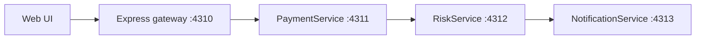

# LaunchDarkly microservices demo

A localhost-only, synthetic payment journey showing independent feature testing and a
coordinated guarded release. No real payments or messages are sent.

## Prerequisites

- .NET 8+ SDK, Node.js 20.12+ and npm.
- Internet access and a LaunchDarkly project with Test and Production environments.
- Each environment’s server-side SDK key and the flags described below.
- Optional: an existing k6 installation for load generation.

## Run

From the repository directory, create `.env` if it does not already exist:

```sh
cp -n .env.EXAMPLE .env
```

Fill in the two keys privately:

```dotenv
LD_SDK_KEY_TEST=
LD_SDK_KEY_PROD=
```

Choose the environment with the launcher argument (works from fish too):

```sh
bash run.sh test
# Or:
bash run.sh prod
```

The launcher selects the matching named key, builds the services and starts the UI.
A missing selected key fails before builds/startup. Keys stay server-side; never commit
`.env` or pass keys to the browser or k6. Do not source `.env` into fish.

Open **http://localhost:4310**. Ctrl-C stops the demo. Stop the current instance before
switching modes, then run the other command.

## Request flow



All service calls use HTTP. The response returns through the same chain. Each service
evaluates its own LaunchDarkly flag using the same `user` context: `key`, `amount`,
and `combination`. Requested toggles are context attributes, never flag overrides.

## Test and Production

**Test:** choose Payment Tester (100), Risk Tester (010), Notification Tester (001), or
Customer (000). Expand **Combination Testing** for manual toggles; opening either
accordion collapses the other without losing selections. The coverage table exercises
all eight combinations. Actual 011 deliberately returns a compatibility error.

Configure Test flags independently: targeting ON, default/OFF false, no prerequisites,
with a `user.combination` rule serving true for:

| Flag | True combinations |
|---|---|
| `payments-v2` | 100, 101, 110, 111 |
| `risk-v2` | 010, 011, 110, 111 |
| `notifications-v2` | 001, 011, 101, 111 |

**Production:** hide test controls and use **Randomize user ID** to select a fresh,
stable synthetic identity. Actual evaluations determine whether it receives V1 or V2.
For coordinated release, each child requires `payment-journey-v2 = true`, with child
targeting ON, default true and OFF false. Configure any master rollout in LaunchDarkly.
Approximately 20% of otherwise successful actual all-V2 journeys return a clearly marked
synthetic HTTP 500; V1 and Test receive no random faults.

PaymentService tracks `payment-journey-error` (0/1) and `payment-journey-duration-ms`
once per valid journey, including failures. Configure separate numeric average metrics
for context kind `user`, lower is better, excluding contexts without events. Metrics are
means per user context; repeated identities are not a global request error rate.

## Optional k6 run

With the demo already running in Prod, use a second terminal:

```fish
k6 version
k6 run scripts/guarded-release.k6.js
# Larger bounded sample: 10 requests/s for 5 minutes
env RATE=10 DURATION=5m PRE_ALLOCATED_VUS=20 MAX_VUS=50 k6 run scripts/guarded-release.k6.js
```

Default: 2 requests/s for 30 seconds, 2 preallocated/4 maximum VUs. Each iteration creates
a fresh user key. The larger run targets 3,000 users; at a steady 5% allocation, about
150 receive V2 on average. Counts and guarded rollback are not guaranteed. Check dropped
iterations; recognized synthetic 500s pass checks but still count as HTTP failures.
Inspect incoming metric events and guarded-rollout results in your LaunchDarkly project.

Keep this unauthenticated demo on localhost. No rollout starts automatically.
